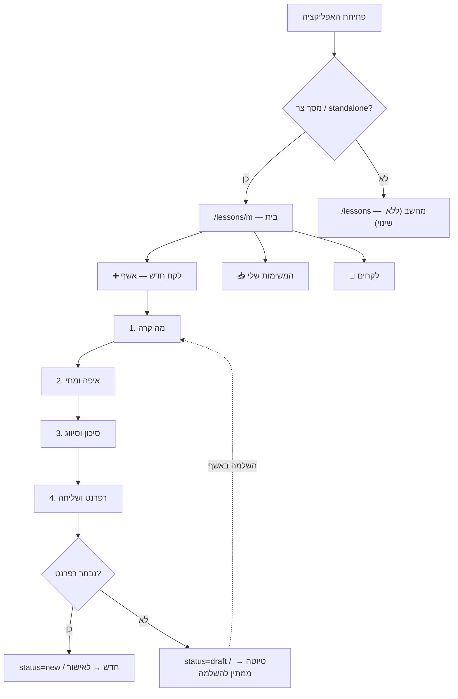

# PLAN — מערכת לקחים כאפליקציית טלפון (שלב 1)

**סטטוס:** M0 + M1 + M2 נבנו (2026-10-16). M0 ממתין לאישור אבטחת מידע ל-90 יום (`LESSONS_REMEMBER_DAYS`). M3–M4 לא התחילו.
**מטרה:** עובד בשטח מזין לקח מהטלפון בפחות מ-2 דקות, משלים טיוטה מהטלפון, ומטפל במשימות שלו (רפרנט / מאשר) בלי מחשב.

## 1. החלטות הבעלים (2026-10-16)

| # | החלטה |
|---|---|
| M-D1 | היקף: **הזנה + צפייה + טיפול**, בדגש על **הזנה**. |
| M-D2 | הזנה = **אשף שלב-אחר-שלב, בלי AI**. |
| M-D3 | מכשירים מעורבים (iPhone + Android); **כניסה פעם אחת לתקופה ארוכה** (90 יום). |
| M-D4 | אין תור offline. **מספיקה שמירת טיוטה** — מה שהוקלד לא הולך לאיבוד כשהשליחה נכשלת. |
| M-D5 | חובה מינימלית בלבד, אבל **כל ההשלמה אפשרית דרך האשף בטלפון**. |

## 2. מה קיים היום (נבדק בקוד)

| נושא | מצב | איפה |
|---|---|---|
| PWA | קיים: manifest עברי RTL, `standalone`, אייקונים, service worker, דף `/install` | `lessons_ui/vite.config.ts`, `pages/Install.tsx` |
| יצירת לקח | דיאלוג מחשב אחד, ~15 שדות ב-4 אזורים | `pages/Lessons.tsx:805` (קובץ של 1,619 שורות) |
| כללי טיוטה/רפרנט | מקור אמת יחיד, בדוק | `lib/lessonAssignment.ts` |
| כותרות שדות | ניתנות לעריכה ע"י אדמין (`getLabel`) | `components/FormFieldManager.tsx` |
| טיפול רפרנט / יישום | 3 כפתורים קיימים (`handleReferentRespond`, `handleRespond`) | `pages/LessonDetail.tsx` |
| כניסה | עמוד `/login` של Shan-AI — **מחוץ ל-scope של ה-PWA** (`/lessons/`); cookie `access_token` ל-7 ימים | `app/routers/login.py:78` |
| סרגל עליון | ה-navbar של Shan-AI מצויר מעל האפליקציה; היציאה (logout) נמצאת רק שם | `/lessons/api/_navbar` |

## 3. הגישה: מעטפת מובייל נפרדת, לא "רספונסיבי" על הקיים

**החלטה מומלצת:** מסכים ייעודיים תחת `/lessons/m/*` עם סרגל לשוניות תחתון. המסכים הקיימים נשארים כמו שהם למחשב.

| חלופה | למה לא |
|---|---|
| להפוך את `Lessons.tsx` לרספונסיבי | 1,619 שורות, 20+ פילטרים, קנבן — שכתוב מסוכן שיפגע גם במחשב |
| אפליקציה נייטיב (App Store / Play) | חשבון מפתח, review של אפל, עדכונים איטיים. ה-PWA כבר מותקן למסך הבית — אין מה להרוויח בשלב 1 |
| Telegram כממשק הזנה | אשף עם בחירות מרובות, תמונה ועריכת טיוטה — טלגרם מגושם בזה. אפשר להוסיף בעתיד כקיצור דרך |

**כלל ברזל — אין כפילות לוגיקה:** בניית ה-payload של לקח חדש, שדות החובה וכלל הטיוטה/רפרנט יוצאים מ-`Lessons.tsx` לקובץ אחד `lib/lessonCreate.ts`. הדיאלוג במחשב והאשף בטלפון קוראים שניהם לאותה פונקציה. אחרת, תוך חודש יהיו שני כללים שונים ל"מה זה טיוטה".

## 4. שלבי ביצוע

### M0 — כניסה שעובדת על טלפון אמיתי (S) — חוסם את כל השאר
1. **בדיקה ידנית על iPhone + Android**: התקנה למסך הבית → כניסה → סגירת האפליקציה → פתיחה מחדש למחרת. ב-iOS לאפליקציה מותקנת יש מאגר cookies נפרד מ-Safari, ו-`/login` נמצא מחוץ ל-scope. **לא ידוע לי בוודאות** אם הכניסה תעבור לתוך האפליקציה — זה בדיוק מה שהבדיקה בודקת.
   **עדכון 2026-10-16:** לבעלים אין iPhone. Android נבדק עכשיו; iPhone נדחה — **חובה לפני הפיילוט (M4)**, על מכשיר של אחד ממשתתפי הפיילוט. סעיף 2 (כניסה בתוך ה-scope) נבנה בכל מקרה, כך שהסיכון ב-iOS יורד גם לפני הבדיקה.
2. עמוד כניסה **בתוך ה-scope**: `/lessons/m/login` (React) ששולח ל-`POST /login` הקיים עם `next=/lessons/m/`. בלי שינוי בלוגיקת האימות.
3. **"זכור אותי במכשיר הזה"** → cookie ל-90 יום (M-D3). ⚠️ זה אותו cookie של כל Shan-AI — הוא פותח גם את הדשבורדים ל-90 יום. **צריך אישור אבטחת מידע** (אותה רגישות כמו PLAN.md §8.1). חלופה אם יסרבו: cookie ייעודי עם `path=/lessons` שתקף רק במודול.
4. במצב standalone: להסתיר את ה-navbar של Shan-AI (חוסך ~60px) ולהעביר "יציאה" למסך "אני".

### M1 — אשף הזנה (M) — עיקר השלב
| שלב | שדות | חובה | צורת קלט |
|---|---|---|---|
| 1. מה קרה | כותרת, תיאור, המלצה | כותרת + תיאור | מקלדת מלאה; המיקרופון של המקלדת (הכתבה של מערכת ההפעלה, בעברית, לא AI שלנו) |
| 2. איפה ומתי | פרויקט, שלב, תאריך אירוע | פרויקט | חיפוש עם "הפרויקטים שלי" (`assigned_projects`) ראשונים; תאריך = היום |
| 3. סיכון וסיווג | רמת סיכון, קטגוריה, תחום מקצועי, ציוד, השפעה (לו"ז / ₪ / איכות) | רמת סיכון | כפתורים גדולים / chips — לא dropdown; השפעה מקופלת כ"אופציונלי" |
| 4. תמונה ושליחה | צילום / קובץ, אחראי ליישום (רפרנט), סיכום | — | מצלמה ישירות (`capture`); רשימת רפרנטים מ-`referentOptions` |

- **מינימום לשמירה:** כותרת, תיאור, פרויקט, רמת סיכון → "שמור טיוטה" זמין מכל שלב אחרי שהם מולאו.
- **שליחה לאישור** רק עם רפרנט (כלל קיים, `lessonAssignment.ts`). בלי רפרנט = טיוטה בשרת, גלויה ליוצר בלבד.
- **השלמה (M-D5):** "הטיוטות שלי" → פתיחת אותו אשף עם הנתונים, וכל שלב מסומן ✓ / חסר. אין טופס שני.
- **הגנה מאיבוד (M-D4):** כל הקלדה נשמרת ב-`localStorage` לפי משתמש. שליחה שנכשלה → הבאנר "לא נשלח — נסה שוב", הטקסט נשאר. אחרי הצלחה בשרת — הטיוטה המקומית נמחקת. **שתי טיוטות שונות** (מקומית שלא נשלחה / טיוטה בשרת) יקבלו שתי תוויות שונות — אחרת עובד יחשוב ששלח.
- **תמונות:** כיווץ בטלפון ל-~1600px JPEG לפני העלאה (צילום של 4–8MB על קליטה חלשה = כישלון שקט).
- כותרות השדות מ-`getLabel` — אותן כותרות שהאדמין הגדיר.
- כפתורי מגע ≥ 48px, `inputmode` מתאים (מספרים לימים / ₪), כפתור "הבא" דביק מעל המקלדת.

### M2 — צפייה (S)
- **בית:** כפתור ➕ ענק, "הטיוטות שלי", מונה "ממתין לי".
- **לקחים:** חיפוש + 2 פילטרים (פרויקט, "שלי"), כרטיסים במקום טבלה, גלילה אינסופית.
- **דף לקח:** קריאה בלבד, תמונות במסך מלא. עריכה = פתיחת האשף.

### M3 — טיפול (M)
- **📥 המשימות שלי:** ביקורות רפרנט ויישומים שממתינים לי — 3 הכפתורים הקיימים (רלוונטי ויושם / רלוונטי, לא יושם / לא רלוונטי), כ-cards.
- **מנהל מודול:** תור אישור לקחים חדשים → `apply_lesson_workflow_event` הקיים (אותה קריאה של המחשב).
- כל כתיבה עוברת `lessons_access.check_request` בגייטוויי — אין צורך בהרשאות חדשות.

### M4 — פיילוט ומדידה (S)
- 10 עובדים (פיקוח + הרכבות), שבועיים.
- מדדים: זמן מפתיחה עד שליחה, % טיוטות שהושלמו, כמות לקחים מטלפון לעומת לפני.
- סימון מקור: עמודה `source` (text) ב-`lessons.lessons` דרך `lessons_schema.py` — בתוך schema `lessons` בלבד. אופציונלי; בלעדיה אי אפשר להוכיח שהאפליקציה עזרה.

## 5. מה **לא** בשלב 1
- AI (הכתבה קולית שלנו, פירוק טקסט לשדות) — הוחלט: בלי AI.
- תור שליחה offline — הוחלט: טיוטה מספיקה.
- התראות push — ב-iOS עובד רק באפליקציה מותקנת ודורש VAPID + שירות שליחה. מועמד לשלב 2 (או קישור מהבוט בטלגרם).
- דשבורדים, קנבן, ניהול, ייצוא — נשארים במחשב.
- מודולים אחרים (חדר מבצעים וכו') — המעטפת `/m/` נבנית כך שאפשר להוסיף לשונית, אבל לא בשלב הזה.

## 6. סיכונים

| סיכון | השפעה | מענה |
|---|---|---|
| כניסה לא נשמרת ב-iOS standalone | האפליקציה לא שמישה | M0 נבדק על מכשיר **לפני** כל קוד אחר |
| אבטחת מידע לא מאשרת cookie ל-90 יום | כניסה כל שבוע | cookie ייעודי ב-`path=/lessons` |
| שני מסלולי יצירה מתפצלים בכללים | טיוטות "נעלמות" | `lib/lessonCreate.ts` + טסטים משותפים |
| טיוטה בשרת גלויה ב-PostgREST (פילטר UI בלבד, כבר מתועד) | לא שינוי מהיום | ללא שינוי בשלב 1 |
| עובדים לא מתקינים | אף אחד לא משתמש | QR בכל תחנה / ישיבת צוות + `/install` עם הוראות לכל מערכת |

## 7. בדיקות
- **vitest:** `lessonCreate.ts` — מינימום, טיוטה מול חדש, השלמה לא דורסת שדות קיימים, לא מכפיל `referent_reviews`.
- **Playwright במסך טלפון** (Chromium מותקן): אשף מלא על build, בלי DB (API מדומה).
- **ידני על מכשירים:** iPhone (Safari → מסך הבית) + Android (Chrome) — M0, אשף, צילום.
- לפי CLAUDE.md: המודול עובר **PR — אין מיזוג ל-master בלי הבעלים**.

## 8. הערכת היקף (גסה)

| שלב | גודל | תלוי ב |
|---|---|---|
| M0 כניסה | S | אישור אבטחת מידע לסעיף 4.M0.3 |
| M1 אשף | M | M0 |
| M2 צפייה | S | M0 |
| M3 טיפול | M | M2 |
| M4 פיילוט | S | M1–M3 |
