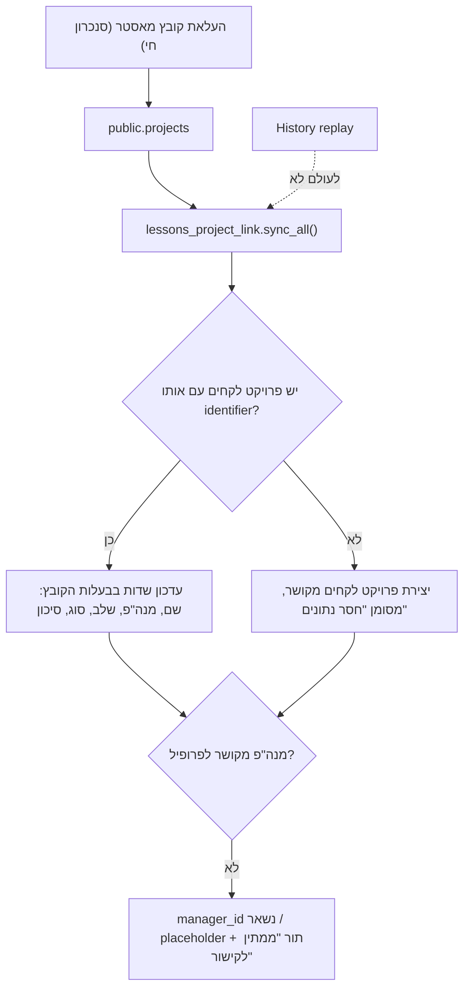

# PLAN — קישור פרויקטים: קובץ המאסטר ↔ מערכת לקחים

**סטטוס:** L0–L4 נבנו (2026-10-17). L5 (רשימת עבודה + השלמת נתונים + Excel) נבנה ב-2026-10-19. הבדיקה מול נתונים אמיתיים בפרודקשן.
**מטרה:** כל פרויקט בקובץ המאסטר קיים גם ברשימת הפרויקטים של מודול הלקחים, מקושר, עם מנה"פ, שלב, סוג וסיכון שנקבעים מהקובץ. פרויקט חדש בקובץ מתווסף ללקחים מעצמו.

## 1. החלטות הבעלים (2026-10-17)

| # | החלטה |
|---|---|
| LP-D1 | היקף: **כל הפרויקטים בקובץ, כולל אלה שהסתיימו** (~263 פעילים + ~41 שהסתיימו). פרויקט שהסתיים = שלב "הסתיים" בלקחים. |
| LP-D2 | פרויקטי לקחים קיימים: **הצעה (rapidfuzz) + אישור אדמין + מיזוג**. אין קישור אוטומטי לפי שם (CLAUDE.md). |
| LP-D3 | **מנה"פ = הקובץ קובע**: מנה"פ בקובץ → `manager_aliases` → `users` → `lessons.profiles.shan_user_id` → `projects.manager_id`. בפרויקט מקושר המנה"פ נעול בלקחים. |
| LP-D4 | שדות שאין בקובץ (סוג תחנה, אתר, ציוד): **מנה"פ משלים את שלו + אדמין בטבלה רוחבית**. |
| LP-D5 | **שלב = הקובץ קובע**, דרך מפה אחת בקוד. נעול בלקחים בפרויקט מקושר. |
| LP-D6 | **סיכון = דרגת הטיפול של מנוע הדפוסים** (`insight_triage`): 🔴/🟠 → high, 🟡 → medium, 🟢 → low. |
| LP-D7 | "ניידות" בקובץ → **סוג פרויקט חדש בלקחים `mobility` ("ניידות")**. |
| LP-D8 | "לקראת ביצוע" → בחירת קבלן [4]. "הסכם- אגירת אנרגיה" = פרויקט בביצוע → [5, 6]. |
| LP-D9 | מנה"פ לא מקושר בפרויקט חדש → פרופיל placeholder "טרם שויך" (`is_login=false`). |
| LP-D10 | שינוי שם בקובץ מעדכן את `lessons.projects.name` בלבד; `lessons.project_name` של לקחים קיימים לא נוגעים. |
| LP-D11 | "הסכם- אגירת אנרגיה" עובר גם בדפוסים: מגזר ניהול פרויקטים → **מגזר ביצוע** (`stage_sectors.py`). |
| LP-D13 | **אין ברירות מחדל לא מבוססות** (2026-10-19): שלב או סוג פרויקט שהקובץ לא נותן → הפרויקט לא נוצר וממתין להשלמת אדמין (בלשונית או ב-Excel). סיכון = כלל מחושב תמיד; מנוע שנפל → לא כותבים סיכון ולא יוצרים. |
| LP-D14 | **אין החלפת מנה"פ בלי אישור אדמין** (2026-10-19): הסנכרון ממלא מנה"פ רק בפרויקט שנמצא אצל "טרם שויך". מנה"פ אמיתי שונה מהקובץ → "ממתין לאישור" ברשימה. |
| LP-D15 | **רשימת עבודה** (2026-10-19): הלשונית מציגה כברירת מחדל רק פרויקטים עם בעיה פתוחה (`link_issues`); מטופל יוצא מהרשימה ונראה רק ב"טופלו" (בקרה), וחוזר רק עם בעיה חדשה. סוג תחנה / אתר / ציוד **לא** משאירים פרויקט ברשימה (החלטה א). **ציוד אינו שדה חובה בכלל** — לא נחשב "חסר נתונים". |
| LP-D16 | **ניידות לא נכלל בהפקת לקחים** (2026-10-19): לא נוצר, לא מוצע לקישור; פרויקטי ניידות שכבר נוצרו מוסרים בכל סנכרון — רק אם אין עליהם לקחים/הפצות; עם לקחים — נשארים ומדווחים. |
| LP-D17 | **פרויקט לקחים אחד שלא הוחלט לא עוצר יותר את כל היצירה** (2026-10-19, "עדיין חסרים המון פרויקטים"): רק פרויקט קובץ שדומה לפרויקט לקחים פתוח (`possible_duplicates`: המלצה / מזהה בשם / דמיון ≥60) ממתין להחלטה עליו; כל השאר נוצרים מיד. |
| LP-D18 | **מחיקה מרשימת ההשלמה** (2026-10-19): "מחק" מוציא פרויקט קובץ ממערכת הלקחים (לא נוצר, לא מוצע, לא נשאל) — רק אם אין פרויקט לקחים מקושר אליו; הפיך מ"טופלו" ← "הוצאו מהפקת לקחים"; קובץ המאסטר לא משתנה. |
| LP-D12 | **בדיקת מנה"פ בכל קישור** (2026-10-17): אחרי קישור, אם המנה"פ בקובץ לא תואם למנה"פ בלקחים או לא מזוהה — המערכת שואלת: להעביר לפי הקובץ / "זה הוא" (בחירת משתמש → נשמר ב-`manager_aliases`, משתמש שאינו מנה"פ מוגדר כמנה"פ) / להשאיר. "להשאיר" נשמר ב-`shan_manager_kept` מול שם הקובץ, ונשאל שוב רק כשהקובץ ממנה מישהו אחר. **L3 לא דורס מנה"פ שנשמר כך.** |

## 2. מה קיים היום (נבדק בקוד)

| נושא | מצב | איפה |
|---|---|---|
| עמודת קישור | `lessons.projects.shan_project_identifier` קיימת, בלי FK (בכוונה), **אף אחד לא כותב אליה**. הייבוא רק משמר אותה | `lessons_schema.py:116`, `lessons_import.py:181` |
| שדות חובה בלקחים | `name`, `manager_id` (NOT NULL, מזהה פרופיל), `stage_indexes` (≥1), `risk`, `project_type`, `station_type` | `lessons_schema.py:116` |
| שמות → משתמשים | `manager_aliases` + מסך קישור באישור אדמין | `models.py:937`, `/dashboard/projects/insights/access` |
| פרופיל ↔ משתמש | `lessons.profiles.shan_user_id` | `lessons_schema.py:158` |
| שערי כתיבה | כל כתיבה ללקחים עוברת דרך `lessons_access.check_request` | `lessons_access.py:201` |
| סנכרון חי | `sync_projects_file` → `deactivate_missing` (רק בסנכרון חי, לא ב-history) | `project_sync.py:417`, `routers/projects.py:136` |
| סוגי פרויקט בקובץ | הקמה / הרחבה / שוש / ניידות | `projects_menu_service.py:33` |
| סוגי פרויקט בלקחים | `new_build` / `expansion` / `maintenance` | `lessons_ui/src/context/UserContext.tsx:91` |

**אין לי גישה ל-DB (הוראה 2026-09-26)**, ולכן אין מספרים על כמה פרויקטי לקחים קיימים ועל כמה מהם יתאימו. את זה מודדים בפרודקשן במסך התצוגה המקדימה של שלב L1, שלא כותב כלום.

## 3. הזרימה

## 4. שדות: מי הבעלים

| שדה בלקחים | בעלים בפרויקט מקושר | מקור |
|---|---|---|
| `name` | הקובץ | `projects.name` |
| `manager_id` | הקובץ | alias → user → profile (LP-D3). אם אין קישור, לא משנים, ומוסיפים לתור |
| `stage_indexes` | הקובץ | `STAGE_MAP` (§5) |
| `project_type` | הקובץ | הקמה→`new_build`, הרחבה→`expansion`, שוש→`maintenance`, ניידות→`mobility` |
| `risk` | הקובץ (המנוע) | `insight_triage` (LP-D6) |
| `station_type` | לקחים (מנה"פ/אדמין) | — |
| `site` | לקחים | — |
| `equipment_ids` | לקחים | — |

- **נעילה בצד השרת:** `check_request` דוחה PATCH על שדות בבעלות הקובץ כשיש `shan_project_identifier`. נעילה ב-UI בלבד לא מספיקה.
- **"חסר נתונים"** מוגדר בפונקציה אחת בלבד, `lessons_admin.project_problems`, בדומה ל-`person_problems`. אותה פונקציה מזינה את התג אצל מנה"פ ואת הטבלה של האדמין.
- `station_type` חסר → עמודה חדשה `station_type_set boolean`. ברירת המחדל `closed` לא יכולה להבחין בין "נבחר" ל"לא נבחר".

## 5. מפת שלבים (`STAGE_MAP`, ליד `stage_sectors.py`)

| שלב בקובץ | אינדקסים בלקחים | ודאות |
|---|---|---|
| הקפאת תכולה | [0] | ✅ |
| הקפאת תצורה | [1] | ✅ |
| תכנון | [2] | ✅ |
| קבלת היתר | [3] | ✅ |
| בחירת קבלן | [4] | ✅ |
| עבודה אזרחית | [5] | ✅ |
| הרכבה חשמלית | [6] | ✅ |
| הרכבה חשמלית ובדיקות | [6, 7] | ✅ |
| בדיקות | [7] | ✅ |
| עבודה אזרחית והרכבות | [5, 6] | ✅ |
| טופס 4 | [8] | ✅ |
| הסתיים | [9] | ✅ |
| לקראת ביצוע | [4] | ✅ LP-D8 |
| הסכם- אגירת אנרגיה | [5, 6] | ✅ LP-D8 |
| ריק / לא מוכר | ללא שינוי + התראת איכות נתונים | — |

השלב "חישמול" [10] קיים רק בלקחים. הקובץ אף פעם לא כותב אותו.

## 6. שלבי ביצוע

### L0 — סכמה (S)
- `lessons.projects`: `ADD COLUMN IF NOT EXISTS shan_active boolean`, `shan_synced_at timestamptz`, `station_type_set boolean NOT NULL DEFAULT true`. הכול ב-`lessons_schema.py` (schema `lessons` בלבד).

**L0 כפי שנבנה:** `DEFAULT true`, כי כל פרויקט קיים או ידני הוגדר ע"י אדם. הסנכרון (L1/L3) כותב `false` במפורש בפרויקטים שהוא יוצר. הייבוא החוזר משחזר את שלוש העמודות, ו**נעצר לפני כתיבה** אם יש פרויקט שקיים רק במודול (`local_only_projects`; בבדיקה היבשה הוא מדווח ב-`local_projects`). "הסכם- אגירת אנרגיה" עבר למגזר ביצוע ב-`stage_sectors.py` (LP-D11).
- `UNIQUE` חלקי על `shan_project_identifier WHERE NOT NULL`, כדי שפרויקט קובץ אחד לא יקושר לשני פרויקטי לקחים.
- `mobility` ב-`ProjectType` + label "ניידות" ב-UI. צריך לבדוק כל `switch`/`Record` על `ProjectType`, וגם את פרומפט ה-AI של הלקחים.

### L1 — קישור ראשוני (M), אדמין בלבד
- מסך "🔗 קישור פרויקטים" בניהול הלקחים: לכל פרויקט לקחים לא מקושר, 3 הצעות rapidfuzz מהקובץ, וכפתורי **קשר / מזג לתוך / השאר מקומי**.
- **תצוגה מקדימה** (GET, לא כותבת): כמה יתאימו, כמה ייווצרו חדשים, כמה מנה"פים לא מקושרים.
- **מיזוג** (טרנזקציה אחת): `lessons.project_id`, `lesson_implementations` (כולל התנגשות על `unique_lesson_project`), `profiles.assigned_projects` → פרויקט היעד. מחיקת המקור רק אחרי ספירות תואמות, ושורה ב-`activity_logs`.
- "יצירת כל החסרים": פרויקטים מהקובץ שאין להם בן זוג נוצרים בלקחים. רק אחרי שהאדמין סיים לעבור על ההצעות.

**L1 כפי שנבנה:** לשונית "קישור פרויקטים" בניהול מערכת הלקחים (`?tab=project_links`, אדמין), API `/lessons/api/_project_links`, כללים ב-`app/services/lessons_project_link.py` בלבד (`STAGE_MAP`, `TYPE_MAP`, `RISK_BY_LEVEL`, שרשרת המנה"פ). קבוצת המקור = פרויקטים **פעילים** ב-`public.projects` בלבד — השורות הלא פעילות הן רפאים של הסנכרון הישן מכל הגיליונות, לא פרויקטים. "השאר מקומי" נשמר ב-`shan_link_decision`. יצירה חסומה כל עוד יש פרויקט לקחים שלא הוחלט עליו, ולא יוצרת פרויקט עם שלב לא מוכר (מוצג ברשימה). פרויקט שנוצר מקבל מנה"פ מהשרשרת המאושרת בלבד, אחרת "טרם שויך" (`pm_unassigned`, `is_login=false`), ונוסף ל-`assigned_projects` של המנה"פ ושל כל האדמינים. **קישור לא מעתיק שדות** — השדות שבבעלות הקובץ מתעדכנים בפרויקט מקושר רק ב-L3. מיזוג: הלקחים וההמלצות עוברים (התנגשות על אותו לקח: נשארת שורת היעד, ותשובת המקור נלקחת רק אם ליעד אין), ספירות נבדקות לפני ואחרי, והכל ב-`activity_logs`. `lessons.project_name` של לקח שעבר לא משתנה (LP-D10).

### L2 — הקצאת מנה"פ חצי־אוטומטית (S–M)
- הצעה ב-rapidfuzz מ-`manager_aliases` הלא מקושרים אל משתמשי Shan-AI. רק אדמין מאשר. זה המסך הקיים, עם תור "חוסם קישור ללקחים".
- משתמש מקושר בלי פרופיל לקחים → אותו ניהול משתמשים של `/lessons/api/_people` (לא יוצרים משתמשים).
- `manager_id` משתנה → אותו כלל של "מנהל אחד לפרויקט": מעבירים את `assigned_projects` לפרופיל החדש ומסירים מהקודם.

### L3 — סנכרון שוטף (S)
- `lessons_project_link.sync_all(session)` נקרא אחרי `deactivate_missing` בשני מסלולי ההעלאה, **רק בסנכרון חי**. הוא נכשל בשקט (savepoint) ולא מפיל העלאה.
- פרויקט שנעלם מהקובץ → `shan_active=false`. **לעולם לא נמחק**, כי יש עליו לקחים.
- הסיכון מתעדכן מ-`pattern_service.compute_cached` (אותו מקור כמו הדשבורד).

**L3 כפי שנבנה:** `lessons_project_link.sync_after_upload()` נקרא בשני מסלולי ההעלאה אחרי `deactivate_missing`, רק בסנכרון חי, בסשן ובטרנזקציה משלו, ולא מפיל העלאה. `sync_plan` (טהור) קובע לכל פרויקט מקושר: שם / שלב / סוג / סיכון מהקובץ (שלב או סוג לא מוכרים — לא נוגעים); מנה"פ עובר רק לפרופיל שהשרשרת המאושרת מצביעה עליו, לעולם לא נגד `shan_manager_kept`, ושם לא מזוהה לא מזיז אף אחד; פרויקט שיצא מהקובץ → `shan_active=false`, חוזר → `true`. פרויקטים חדשים בקובץ נוצרים **רק כשאין פרויקט לקחים שלא הוחלט עליו** (אחרת הוא עלול להיווצר פעמיים) — עד אז היומן כותב "יצירה מושהית". נעילה: טריגר `lessons.lock_master_fields` דוחה שינוי של שם / שלבים / סוג / סיכון / הקישור עצמו בפרויקט מקושר **רק מתפקיד PostgREST** (`lessons_anon` = כל עריכה מה-UI); הסנכרון ודפי האדמין רצים בתפקיד האפליקציה. מנה"פ לא ננעל ב-DB (עריכת משתמש באדמין כותבת אותו) — הסנכרון מחזיר את מנה"פ הקובץ אלא אם נבחר "השאר".

**L2 כפי שנבנה:** (1) הבדיקה והשאלה לכל פרויקט מקושר (LP-D12); (2) כרטיס "שמות מנה"פ בקובץ" בלשונית קישור פרויקטים — כל שם בעמודת מנה"פ של הקובץ הפעיל (בלי "טרם הוקצאה"), מי הוא, מה חסר, והצעה (`manager_hint`: אותה קבוצת מילים — הקובץ כותב "משפחה, פרטי" — אחרת שם משתמש ב-≥60) מסומנת מראש; "אשר" כותב `manager_aliases` + פרופיל מנה"פ (`confirm_alias`); (3) "סנכרן עכשיו" מריץ את L3 מיד. דף קישור השמות של הדפוסים נשאר — אותה טבלה.

### L4 — השלמת נתונים (S)
- מנה"פ: תג "חסר נתונים" על הפרויקטים שלו, ועריכה של station_type/site/equipment בלבד.
- אדמין: טבלה רוחבית עם פילטר "חסר", עריכה קבוצתית של סוג תחנה ושדות נעולים מוצגים כקריאה בלבד.

**L4 כפי שנבנה:** "חסר נתונים" מוגדר במקום אחד — `lessons_ui/src/lib/projectProblems.ts` (סוג תחנה שלא נבחר `station_type_set=false` · אין אתר · אין ציוד), ולא בשרת כפי שתוכנן: כל נתוני הפרויקט כבר בצד הלקוח, ושני המסכים (מנה"פ + אדמין) קוראים אותה פונקציה. מנה"פ: תג "חסר: …" על כרטיס הפרויקט + פילטר "חסרי נתונים" בדף הפרויקטים, ובדף הפרויקט תג + 🔗. אדמין: לשונית "השלמת נתונים" — כל הפרויקטים (ברירת מחדל: רק חסרי נתונים), עריכה בשורה (סוג תחנה, אתר, ציוד) וסוג תחנה לרבים בבת אחת. שמירת סוג תחנה כותבת `station_type_set=true`. בפרויקט מקושר: בדיאלוג העריכה (דף פרויקט + אדמין) שם / סוג / מנה"פ / סיכון / שלבים נעולים ונשלחים רק השדות של המודול; שינוי שלב מהדף חסום. `updateProject` / `updateProjectStage(s)` / `updateProjectEquipment` זורקים שגיאה כשהשרת מסרב ולא מעדכנים את המסך (קודם התעלמו מהשגיאה — שינוי שנדחה נראה כאילו נשמר).

### L5 — רשימת עבודה, השלמת נתונים, Excel (2026-10-19)
- **`link_issues(row)`** (טהור) — ההגדרה היחידה של "ממתין לטיפול": `undecided` · `manager_differs` · `manager_unresolved` · `manager_placeholder` · `sync_error`. הרשימה, המונים, הודעת "כל הפרויקטים סונכרנו וקושרו בהצלחה…" (`all_clear`), ייצוא ה-Excel וקליטתו קוראים אותה.
- **`missing_fields` / `master_overrides`** — מה שהקובץ לא נותן (שלב / סוג). האדמין משלים בלשונית ("שמירה והמשך סנכרון") או ב-Excel; ההשלמה נשמרת בטבלה server-only `lessons.master_overrides` לפי המזהה בקובץ, ולעולם לא דורסת ערך שהקובץ נותן.
- **סנכרון לכל פרויקט בנפרד** (savepoint): כשל נכתב על הפרויקט (`shan_sync_error`) ובדוח, והשאר ממשיך; נמחק בריצה הבאה שעברה. שורת יומן לכל שינוי בכל פרויקט. דוח לכל ריצה ב-`lessons.sync_runs` (server-only) בחמש קטגוריות: נוצרו · מקושרים ותקינים · ממתינים להשלמת נתונים · ממתינים לאישור מנה"פ · נכשלו.
- **Excel** — `app/services/lessons_link_sheet.py` (טהור): `GET /_project_links/completion.xlsx` (גיליון "להשלמה", שורה לכל פריט, רשימה נפתחת של ערכים חוקיים; מנה"פ לפי שם בקובץ — שורה אחת לשם; משתמש נבחר כ"שם · #id" ונקרא לפי ה-id בלבד). `POST /_project_links/completion?mode=preview|apply`: תא ריק לא נוגע בכלום; פריט שכבר לא פתוח מדולג; "ערך קיים" שהשתנה מאז הייצוא נדחה; ערך לא חוקי נדחה. apply = אותה בדיקה שוב, כל פריט ב-savepoint, ואז סנכרון אחד.

## 7. טסטים (סינתטיים, בלי DB)
- `STAGE_MAP` מכסה כל שלב ב-`stage_sectors`, ושלב לא מוכר לא משנה כלום.
- History replay לא קורא ל-`sync_all`.
- `check_request` דוחה PATCH על שדה נעול בפרויקט מקושר, ומאפשר אותו על פרויקט מקומי.
- מיזוג: הספירות לפני ואחרי שוות, והתנגשות `unique_lesson_project` מטופלת.
- מנה"פ לא מקושר לא דורס `manager_id` קיים.
- "חסר נתונים" = `len(project_problems)` בכל המסכים.
- ה-DDL לא נוגע ב-`public` (הטסט הקיים).

## 8. פתוח / סיכונים
1. ~~`stage_sectors.py`~~ — הוחלט (LP-D11).
2. ~~ייבוא חוזר מוחק פרויקטים מקומיים~~ — נחסם ב-L0. **שים לב:** הייבוא מחליף גם את `lessons.lessons`, כך שלקח שנכתב במודול אחרי ההגירה נמחק בייבוא חוזר. זה היה נכון גם לפני התוכנית הזו. אם יש פרויקטים מקומיים, החסימה תופעל כבר היום.
3. המודול עובר PR עם merge אוטומטי ב-CI ירוק (CLAUDE.md), ואחריו בדיקת deploy.
